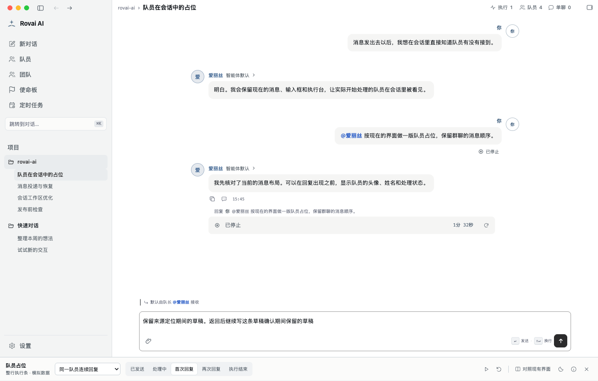
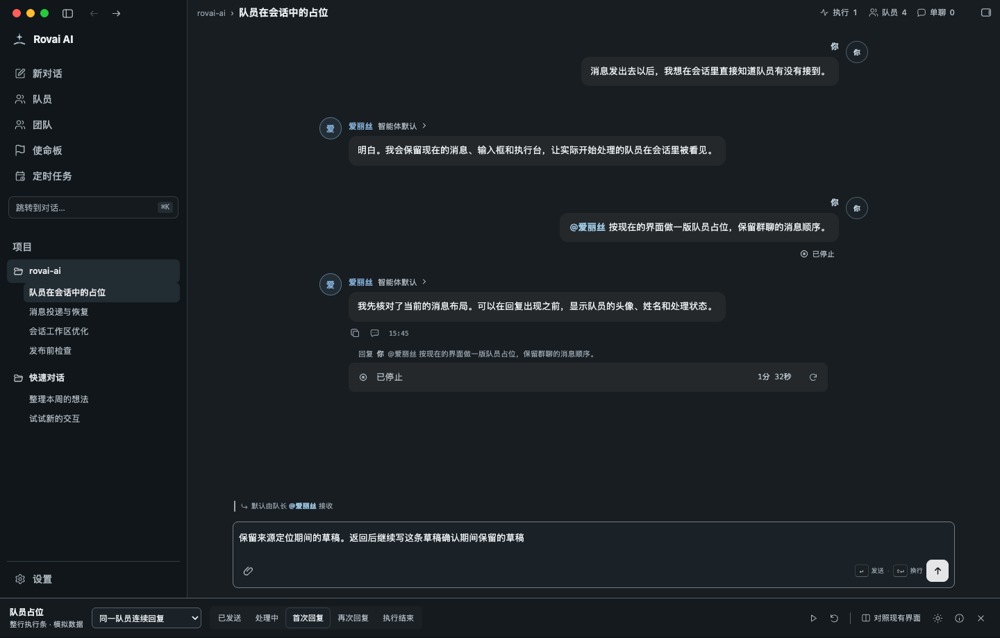

# 手动停止保留执行条验收

2026-10-29 的生产 React 组件与真实 CSS 截图。固定演示投影，不访问日常数据、Core 或真实 Runtime。
手动停止保留静态状态和最终耗时，右侧继续按钮仅显示图标；同一 Run 不重复显示“你已中断”。

复现：`ROVAI_PRESENCE_UI_OUTPUT=/tmp/rovai-presence-review node --test scripts/lib/run-presence.test.mjs`。
该 owner 覆盖切群、刷新、键盘继续、提交禁用、受理后收起、一个新 Run 和成功后移除。

| 日间 | 夜间 |
| --- | --- |
|  |  |
