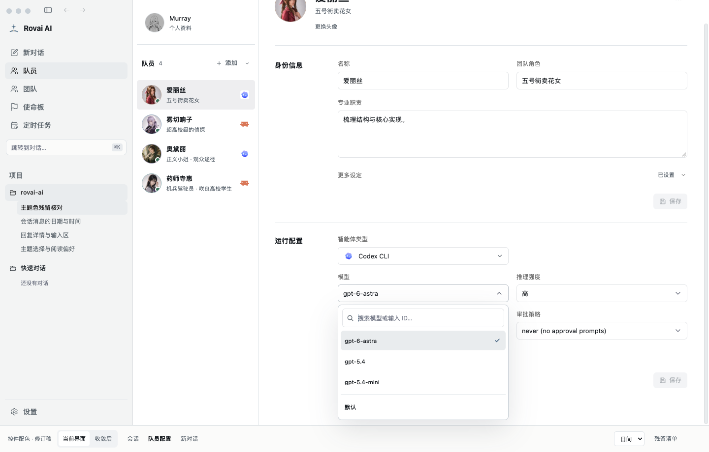
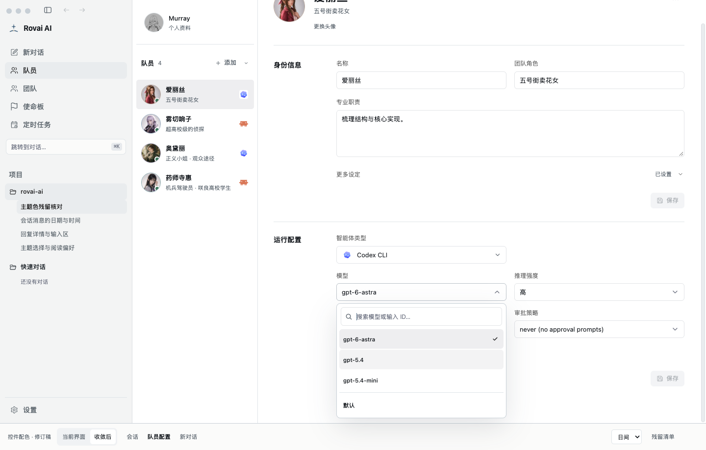
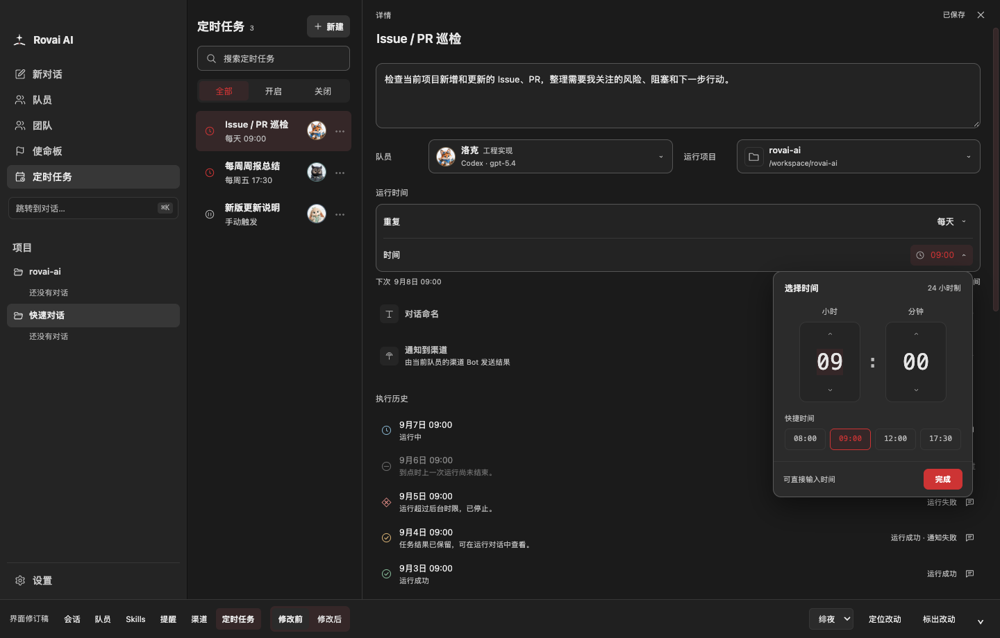
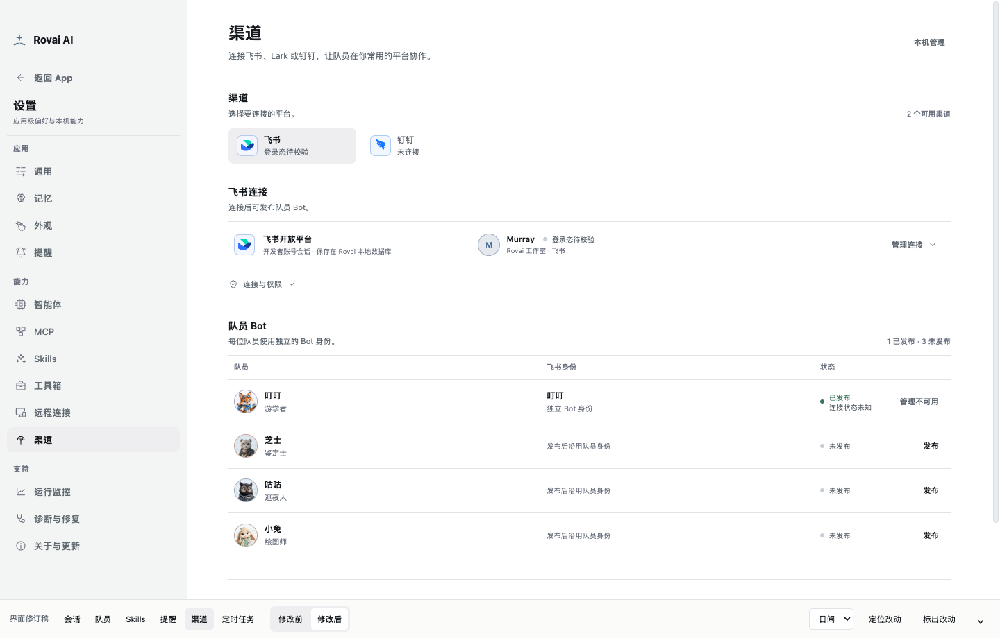

# 控件主题色修订验收

生产 React 组件、真实 CSS 与固定演示数据的浏览器截图；未接入 Core 或真实 Runtime。After 截图使用本次修改后的生产样式，没有加载设计稿的配色覆盖层。

| 场景 | 修改前 | 修改后 |
| --- | --- | --- |
| 队员模型菜单（日间）：选中行、悬停行和勾选标记 |  |  |
| 定时任务（绯夜）：浅色操作文字、Portal 时间菜单 |  |  |
| 渠道（日间）：管理不可用按钮保持单行 |  |  |

验证覆盖会话、队员、Skills、提醒、渠道、定时任务的五套主题；对照确认稿的 30 组颜色与控件尺寸一致。模型及参数菜单、新对话菜单、侧栏菜单、提及候选菜单使用真实交互打开。@ 提及、接收者、身份文字和模型摘要的文字颜色与修改前一致；危险项继续使用危险色。

可复核路径：队员 → 运行配置；设置 → Skills / 提醒 / 渠道；定时任务 → 详情 → 时间。模型下拉的搜索、键盘、输入法和异步目录交互由现有 `pnpm test:runtime-model-picker` 验证。
